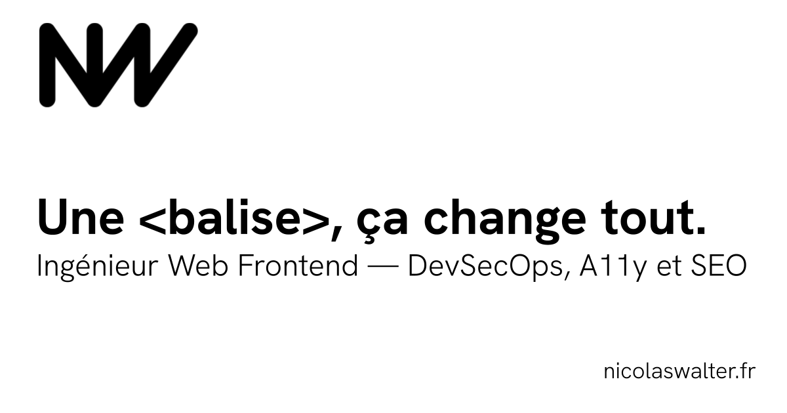

  

 

### 👋 Ingénieur Web Frontend — Sensibilité DevSecOps, A11y & SEO

Je conçois des applications web modernes, performantes et accessibles, en alliant architecture front-end réactive (Vue / Nuxt) et bonnes pratiques d'ingénierie logicielle (CI/CD, sécurité, performance web).

* 🏛️ **Architecture & Composabilité** : Nuxt 4, Vue 3, TypeScript, State Management réactif (Pinia), Design Systems.
* ♿ **Qualité & Conformité** : HTML sémantique, accessibilité numérique (RGAA / WCAG), Core Web Vitals et SEO technique.
* 🛡️ **DevSecOps & Cloud** : Pipelines CI/CD automatisés (GitHub Actions), conteneurisation Docker, linters stricts et sécurité logicielle.

---

### 📬 Me retrouver & Découvrir mes projets

* 🌐 **Portfolio & Études de cas** : [nicolaswalter.fr](https://nicolaswalter.fr)
* 📄 **Curriculum Vitae** : [Consulter mon CV (PDF)](https://nicolaswalter.fr/CV_Nicolas-WALTER.pdf)
* 💼 **LinkedIn** : [linkedin.com/in/wanicolas](https://www.linkedin.com/in/wanicolas/)
* ✉️ **Contact** : [nicolaswalter.fr/contact](https://nicolaswalter.fr/contact)
